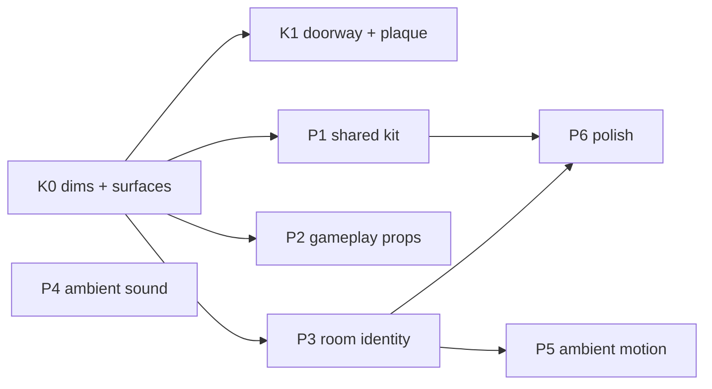

# HW #4 interior asset plan

Assets that make the HW #4 rooms feel lived-in, **in priority order**. Each item has an ID, so a
developer can hand exactly one item (or one tier) to their coding agent.

Related docs: [hw4_rooms_plan.md](hw4_rooms_plan.md) (the rooms), [hw4_team_plan.md](hw4_team_plan.md)
(tracks A/B/C and their tasks).

**Priority rule:** first what every room needs, then what gameplay needs, then what gives each
room its identity, and last pure atmosphere. A lower tier never blocks a room from being playable.

---

## 1. How assets are made (read before starting any item)

We use the same pipeline as the exterior (`assets/exterior/source/tools/README.md`). Nothing is
downloaded or borrowed: every mesh, texture and sound is generated by our own scripts.

- **Where:** `assets/interior/<set>/` holds the game files (`.gltf` + `.bin`, `.png`, `.tres`, `.wav`).
  `assets/interior/source/tools/` holds the scripts (add a `.gdignore` in `source/`, like the other asset folders).
- **Meshes:** Blender background jobs: `blender -b --factory-startup --python <script> -- <out dir>`.
  Use the shared helpers in `int_mesh.py` (parts, atlas UVs, printed faces, export) and `int_art.py`
  (noise, fonts). Export one `.gltf` per prop with the atlas kept as a separate `.png`, so a set's
  props share one texture. **Worked example:** P1.4 (`barrier_bench_art.py`, `barrier_bench_build.py`)
  and P1.6 (`signs_art.py`, `signs_build.py`).
  Each set gets one build script (for example `sculpture_build.py` writes `sculpture.glb`).
- **Textures:** **one texture per set** (`int_kit.png`, `int_sculpture.png`...), drawn by that
  set's own script. Sets never share an atlas, so two people never edit the same texture.
- **Sizes:** all shared sizes live in `int_dims.py` (made in K0). These are the wall height (4 m), wall thickness
  (0.5 m), doorway (3 m wide), and the heights of plinths, benches and cases. Read sizes from it; never hard-code them.
- **Sounds:** plain Python with numpy and scipy, like `make_sounds.py`. **Each sound has its own fixed seed**
  (`np.random.default_rng(<seed>)`), so adding a sound never changes an existing one. Loops get a
  seamless fold (copy `seam()` from `make_sounds.py`).
- **Ready-to-drop scenes:** every prop gets `scenes/props/<name>.tscn` with its mesh, **collision**
  (simple boxes or cylinders, never trimesh on small things) and any lights or sound. Room builders only
  instance these scenes; they never import a `.glb` directly.
- **Budgets:** about 3k triangles per hero prop and 500 per small prop. Textures are 1024² per set,
  512² for small sets. Lights: at most 2 shadow-casting lights per room, because the rooms are
  dark at night and the existing `ReflectionProbe` plus a few omni lights carry them.
- **Readability:** cover objects must be obviously solid (chest height or more, clear outline).
  Anything you can interact with keeps the existing glow cue. Decoration must never look interactable.
- **Credits:** every PR adds its line to README → "Asset credits" ("made for this project...") and,
  for any new engine feature, README → "Godot-provided systems".
- **Tone:** each set gets one or two myth/library jokes in labels and paintings, matching the
  Heel of Achilles, Trojan Van and Last Book of Alexandria. Don't overload it.

### Ownership

An asset item owns its own folder, its own scripts and its own `scenes/props/` scenes. **Room scenes
belong to the room tasks** (Tracks B and C in the team plan): asset items never edit a room scene, and
room tasks only instance prop scenes. `int_dims.py` and the shared kit materials are made in K0
and then frozen. Changes to them need a heads-up to the team.

### Agent prompt template

> Do asset item **K2** from `docs/hw4_assets_plan.md` only. Follow section 1 ("How assets are made").
> Write the generator script(s), run them, create the prop scenes with collision, add the README credit
> line, and run `godot --headless --quit`. Do not edit room scenes or another item's files.

**Done means:** the scripts regenerate the outputs from scratch, the prop scenes load with no errors in the
headless check, the README credit is added, and a human has looked at it in the editor at night lighting.

---

## 2. Priority tiers

| Tier | Theme | Blocks |
|---|---|---|
| **K: Kit foundation** | Sizes, surfaces, doorway | Every room scene and every other asset item |
| **P1: Shared kit** | Props used in every room, cover first | Rooms looking like one museum |
| **P2: Gameplay props** | Things the room rules depend on | B3 Twin Archives, C2/C3 Laser Corridor |
| **P3: Room identity** | Feature props for each room | Players telling the rooms apart in a shuffled order |
| **P4: Ambient sound** | Room tones and one-shots | Nothing (independent) |
| **P5: Ambient motion** | Particles, flicker, small movement | Nothing |
| **P6: Polish** | Wear, decals, a lighting pass | Nothing |

P4 has **no dependencies**, so it can start on day one, in parallel with K0.

---

## 3. Items

### Tier K: Kit foundation *(do first; small)*

**K0: Dimensions + surfaces** ✅ · depends on: nothing (sizes must match the room contract from team-plan task A0: 3 m doorway, 4 m walls)
- `int_dims.py`, and the materials `int_floor_parquet.tres`, `int_floor_marble.tres` (reuse `assets/plates/marble.png`
  if it fits), `int_wall_paint.tres` (two or three wall colours, one per room mood), `int_ceiling.tres`, and
  `int_skirting.tres` plus `int_moulding.tres` (same carved look as `ext_trim`, so inside matches outside).
- A tiny `scenes/props/prop_template.tscn` showing the expected layout (mesh, collision, optional light).

**K1: Doorway frame + room plaque** ✅ · depends on: K0
- A carved frame for the 3 m doorway, in two variants: an open arch, and one with hinges for `RoomGate` doors.
- A brass plaque above each doorway with the room's name ("Sculpture Hall", "The Twin Archives"...).
  The text is a texture per room, made the same way as the plinth labels (`make_card.py`).
- Why it's in tier K: with shuffled rooms, the plaque is how players know where they are.

### Tier P1: Shared kit *(every room uses these)*

In order. Cover comes first because guards and stealth depend on it.

| ID | Asset | Notes |
|---|---|---|
| P1.1 ✅ | **Conservation crates + drop cloths** | Main stealth cover. Three crate sizes (stackable), plus a cloth-draped statue shape. Chest height or more, box collision. |
| P1.2 ✅ | **Glass display cases** | Tall and low variants, with simple contents (pottery, coins, scrolls). The glass blocks movement but not sight, so collision is on and the guard's line of sight passes through. Check this with `guard.gd`'s ray (its collision mask). |
| P1.3 ✅ | **Framed paintings + picture lights** | Five or six paintings in three frame sizes, with myth jokes (e.g. *"Narcissus, Self-Portrait #47"*). The picture light is a small emissive bar, not a real light, except for one optional real spot per room. |
| P1.4 ✅ | **Rope barriers + benches** | Brass posts and red rope (posts have collision, the rope doesn't), and a padded gallery bench. |
| P1.5 ✅ | **Ceiling fixtures** | Pendant lamp, recessed light panel, an emissive EXIT sign (green, reads well at night), and a wall vent. |
| P1.6 ✅ | **Info stand + floor sign** | "Do not touch" stand and "Wet floor" A-frame are done. A "Gallery closed" sign is still open. |

### Tier P2: Gameplay props *(the room tasks need these to be fully playable)*

| ID | Asset | Needed by | Notes |
|---|---|---|---|
| P2.1 ✅ | **Laser emitter posts + beam look** | C2 laser grid, C3 Laser Corridor | A post mesh plus a beam material/shader (an additive red line with flicker) that turns off cleanly when `is_active` is false or jammed. The **behaviour stays in C2**; this item is only the look. |
| P2.2 ✅ | **Switch panel** | C3 fallback switch | A wall- or floor-mounted panel that reads clearly as "stand here". It wraps the existing pressure-plate visuals or matches them. |
| P2.3 ✅ | **Archive shelving walls** | B3 Twin Archives | Tall bookcases (2.5 m and up) that make the wall splitting the two alcoves, with box collision. Book spines come from one texture, varied by UV offset. |
| P2.4 ✅ | **Gadget prop + jammed effect** | C1/C4 gadget | The held gadget model and a small "jammed" spark or flicker for targets. Done: the Hermes Signal Jammer on every belt and raised in your own view, a pulse with sound on every screen, sparks and sputtering beams on a jammed grid. |

### Tier P3: Room identity *(one set per pool room; the sets can run in parallel)*

Each set gives a room its own silhouette and colour, so a shuffled run is still readable.

| ID | Set | Room | Contents |
|---|---|---|---|
| P3.1 | `sculpture` | Sculpture Hall | Three statues on plinths: a discus thrower, a Venus with broken arms, a bust. Icarus's wings hung from the ceiling. One empty plinth labelled "away for cleaning". It reuses `statue_marble.tres`. |
| P3.2 ✅ | `archives` | Twin Archives | Card-catalogue cabinets, a rolling ladder, scroll racks, green reading lamps (emissive), a reading table with open books. |
| P3.3 | `arms` | Laser Corridor ("Hall of Arms") | Two or three suits of armour, a spear rack, and Achilles' shield in a case ("heel sold separately"). |
| P3.4 ✅ | `office` | Security Office | A CCTV monitor wall (screen material only here; the static effect is in P5.2), a desk with a coffee mug and logbook, a key board, lockers, and the librarian's cardigan over a chair. |
| P3.5 ✅ | `lobby` | Entrance lobby | A ticket desk, coat check, donation box, a "Today: The Last Book of Alexandria" banner, and a museum map board. The lobby connects to the exterior's front doors. Done, plus a gift shop banner, the kit surfaces, trim and doorways on the lobby. |

### Tier P4: Ambient sound *(independent: start any time)*

One room tone per room (a loop), plus a few one-shots. Everything is generated, with its own seed per sound.

| ID | Sound | Where |
|---|---|---|
| P4.1 ✅ | HVAC hum (low, steady loop) | Every room, at a different pitch per room so each sounds different |
| P4.2 ✅ | Ticking clock | Lobby, Archives |
| P4.3 ✅ | Fluorescent buzz | Security Office |
| P4.4 ✅ | Faint radio chatter (band-limited noise "voices", no words) | Security Office |
| P4.5 ✅ | Laser hum + "zap" on crossing | Laser Corridor (the behaviour hook is in C2) |
| P4.6 ✅ | Creaky floorboard and page rustle one-shots | Archives (the creak could later become a noise source; see stretch goals) |

Each sound gets an `AudioStreamPlayer3D` inside the relevant prop scene or a `RoomTone` scene, so room
builders just drop it in.

### Tier P5: Ambient motion

| ID | Effect | Notes |
|---|---|---|
| P5.1 | Dust motes in light beams | `GPUParticles3D` (already used for the artifact), very low count, inside picture-light or window beams. |
| P5.2 ✅ | CCTV static + scrolling camera feeds | A shader on the P3.4 screens. Optional: one screen shows a live `SubViewport` of the room (add it to the README systems list if used). |
| P5.3 ✅ | Flickering tube light | Security Office or Laser Corridor. It must not hide the guard's flashlight cue. |
| P5.4 | Slow ceiling fan | Archives or Office. |
| P5.5 ✅ | Moths around the reading lamps | Archives; tiny particles. |

### Tier P6: Polish *(after rooms exist)*

| ID | Item | Notes |
|---|---|---|
| P6.1 | Floor wear + decals | Worn paths in front of exhibits, a scuffed doorway threshold (`Decal` nodes; add to README systems). |
| P6.2 | Lighting pass per room | Tune the omni lights and `ReflectionProbe` per room so each one has its own mood, while players stay visible to each other. |
| P6.3 | Readability check | Play a full shuffled run. Confirm cover reads as cover, interactables glow, and decoration doesn't look interactive. |

---

## 4. Suggested split across the three developers

This fits around the team plan's tracks, so nobody works on files someone else owns.

| Slot | Track A dev | Track B dev | Track C dev |
|---|---|---|---|
| 1 | (busy with A0, A1) | **K0**, then **K1** | **P4** sounds (no dependency) |
| 2 | | **P1.1**, **P1.2** | **P2.1**, **P2.2** (needed by C2/C3) |
| 3 | | **P2.3**, **P1.3** to **P1.6** | **P3.3** arms, **P2.4** after C0 |
| 4 | **P3.5** lobby (with A1's lobby room) | **P3.1**, **P3.2**, **P3.4** | **P5.x** |
| 5+ | **P6** together after CP3 | | |

Any tier P3, P4 or P5 item can move to whoever is free. They share no files.

---

## 5. Stretch assets (only after everything above)

1. **A creaky floorboard that makes noise**: a real noise source through `NoiseSystem`, not just a sound (gameplay, so the team writes the rule).
2. **Security camera model**: for the stretch "security cameras" goal in the team plan; it would be the second jammable target.
3. **Optional loot props**: small valuables in each room for the "scoring" stretch goal.
4. **Skylight with moonlight and rain**: hooks into the exterior's weather (`exterior_wet` shader global).
5. **Pigeon inside**: one pigeon that got into the Sculpture Hall, reusing `pigeon.glb`, and flies off when players come near.
6. **Painting that watches you**: the eyes in one portrait follow the nearest player (a pure shader joke).
