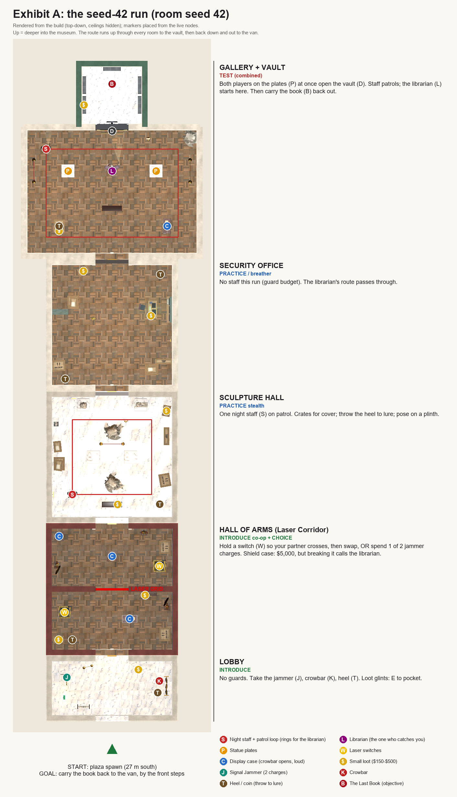

# Exhibit A: HW #4 design and playtest report

**Team:** Eduardo Goncalvez (6526311), Alex Waisman (6529880), Jonathan Serrano (6524435)
**Build tested:** Round 1: the 2026-11-20 local build (no hotbar yet). Round 2: the 2026-11-22 build. Godot 4.7.2 stable, Windows 11.
**Segment:** one full heist on room seed 42: plaza → Lobby → Hall of Arms (Laser Corridor) → Sculpture Hall → Security Office → Gallery + Vault → back out to the van.

---

## 1. Intended experience and test questions

**Intended experience:** *Two players should feel tense but in control as they cover
for each other to get the book out, and should understand why they were caught or why a risk paid off.*

**Test questions:**
1. **Q1:** Can a new pair work out the Hall of Arms' laser grid (the switch hand-off, or spending a jammer
   charge) without a hint? *Measures:* seconds from first seeing the grid to both players past it; alarms set off;
   method; hints.
2. **Q2:** Do players understand the crowbar's cost: when they break a case, do they expect the librarian, and do
   they still choose to? *Measures:* crowbar taken; cases broken; seconds from a break to the librarian
   arriving; debrief answer.

## 2. The segment, mapped

*Rendered from the build (ceilings hidden), with markers placed from the live nodes.*

| Moment | Where | What it does |
|---|---|---|
| **Start** | Plaza, by the van | Both players spawn; the timer starts when the second joins. |
| **Introduce** | Lobby | No guards. The jammer (ticket desk), the crowbar and the Heel (coat check) are in reach; loot glints and the prompt teaches "E to pocket". The hotbar's slots fill as they pick things up. |
| **Introduce co-op + choice** | Hall of Arms | No staff this run. The laser grid blocks the middle: one player holds a switch while the other crosses, then the far switch brings the first over. Or spend one of the jammer's two charges for both at once. The Shield of Achilles case ($5,000) is the first crowbar temptation. |
| **Practice stealth** | Sculpture Hall | One night staff on a patrol loop; crates and draped statues for cover; the Heel to lure her; statue plinths to pose on. |
| **Practice / breather** | Security Office | No staff this run (guard budget); the librarian's route passes through. |
| **Test (combined)** | Gallery + Vault | A staff patrol around both plates and the librarian's start point. Both players must stand on the Achilles and Helen plates **at the same time** to open the vault; then one carries the book (both hands) back through every room under the timer. |
| **End** | Plaza, the van | The book in the van wins; a catch or the timer running out loses. The end card's Restart starts a new run without relaunching. |

**Meaningful choices:**
- **Jammer now or later:** two charges per heist. Spend one at the grid to skip the switch hand-off, or save it
  for the way back with the book.
- **Crack a case or not:** a case's prize is worth $1,500–$5,000 (small loot is $150–$500), but breaking one is a
  10 m noise and the librarian hears it anywhere and comes. The haul only counts if you escape.
- **Who carries the book:** it takes both hands. The carrier can't throw or use the jammer or crowbar; the
  other player has to cover.

**How the camera and interface support the plan:** first-person camera; the top bar shows time left, the
book's state ("locked in the vault", "vault open!", "carried by your partner"), the haul and the alert. Prompts
name what you're aiming at ("Press E to pocket: Ring of Gyges ($300)", "Left click: pry it open (loud!)"). The
hotbar shows what you hold and the jammer's charges. Each vault plate lights a lamp on the vault door while it's
pressed. "She's coming…" appears on both screens when a staff rings or a case breaks. Loot glints. EXIT signs
and cold moonlight at the front doors mark the way out. The objective and every control are on a card beside
the main menu, on screen for the first 8 seconds of each heist, and back whenever a player holds Tab ("Tab:
controls" stays on the top bar).

## 3. How the systems interact

**Guard budget × noise × the librarian's response.** A run keeps one night staff per two rooms behind the
lobby (`GuardBudget.ROOMS_PER_STAFF = 2`): two staff, plus the librarian, who roams every room. Staff never catch;
they ring a bell every 3 s while they can see you, and every bell sends the librarian hurrying to where you were
seen (her investigate speed is 3 m/s; her chase speed is 4.5 m/s, faster than sneaking at 2.5 but slower than
walking at 5). Noise works on distance: a thrown Heel is heard within 8 m, a coin within 6 m, and a breaking
case within 10 m. A case is also heard by the librarian anywhere.

So the number of staff decides how often the librarian is pulled across the museum, and that decides how safe
the risky actions (a loud case, a mistimed hand-off at the grid) really are.

**A parameter change and its consequence:** with `ROOMS_PER_STAFF = 1`, a normal run would keep four staff
instead of two: every room behind the lobby watched. Bells would come far more often, the librarian would rarely
be on her quiet route, and breaking a case would almost always have a staff member within 10 m. Pocketing loot
would become a much worse bet, and the timer (180 s + 30 s per pool room) would get tight. Two staff leave some
quiet rooms where the crowbar is tempting. The playtests point the same way: on the Round 1 build, before the budget, P1 said "there were too many guards" and S1 was caught 3 times; on the budgeted build P1 and P2 were caught once (section 8; familiarity also played a part).

**Timer × room order:** the seed decides the rooms, and the timer grows by 30 s per pool room, so a three-room
run gets 4:30. Carrying the book means walking the whole route twice, so time pressure peaks on the way out.

## 4. HW #3 feedback response

The HW #3 feedback (Kianoosh Boroojeni) praised the prototype's student-written co-op rules, synced heist state,
puzzle, artifact and extraction, guard, throwable noise, HUD and restart, and the README's separation of engine
services from team-written systems. **It asked for no corrections.** So there was nothing to fix; the table shows
how we kept what it praised, and how we followed the HW #4 scope from the approved proposal's feedback, which was
actionable.

| Feedback item | Change or justified deferral | File/system or build evidence | Verification / next step |
|---|---|---|---|
| HW #3: no corrections requested; the core co-op loop (plates, artifact, extraction, guard, throwable noise, HUD, restart) works. | Kept the loop and built HW #4 on it. The vault puzzle, drop zone and restart rules are unchanged. The artifact rule changed only so the book can be picked up with hotbar items stowed. The single guard became the librarian plus night staff. | `vault_puzzle.gd`, `artifact.gd`, `drop_zone.gd`, `game_state.gd`; `boss.gd`, `staff.gd` | Confirmed in the playtests: all 3 sessions played the full loop (plates → book → van → end card), and every pair used Restart after a catch before winning (`hw4_playtest_log.csv`). |
| HW #3: the README separates engine services from team-written systems. | Every HW #4 system was added to both lists as it was built, including the new engine features we used. | README: "Godot-provided systems" (e.g. Decal, SubViewport icons, render layers); "Systems we wrote" (room ordering, guard budget, hotbar, loot) | Checked in each pull request; reread before submission. |
| HW #3: the README explains GenAI use and verification. | Rewrote the GenAI statement for HW #4, because Claude Code's role grew: it now says what it wrote and proposed, gives real prompts, and says how we checked it. | README: "GenAI statement" (PR #65) | Each member described their own AI use in the README, and all three confirmed they can explain the main systems and their own contributions. |
| Proposal feedback (HW #4 scope): add a small number of rooms. | Four pool rooms; each run uses three, between the lobby and the gallery/vault. | `scenes/rooms/` (Sculpture Hall, Twin Archives, Laser Corridor, Security Office); `room_catalog.gd` | Each room built and its navigation checked (every exit and guard waypoint reachable). |
| Proposal feedback: procedural room ordering. | Our own seeded Fisher–Yates plus a fit-the-building rule; the host builds the rooms and the client receives them. A room seed field replays a run. | `room_order.gd`, `museum_layout.gd`, menu seed field | Same seed → same rooms and night staff across runs and restarts (tested). The loot layout is drawn from the same seed. The playtests all use seed 42. |
| Proposal feedback: one further gadget. | The Signal Jammer: two charges per heist, jams the laser grid. | `gadget_jammer.gd`, `jammer_pickup.gd`, `laser_grid.gd` | Host and client both see who holds it, in hand or on the belt (tested). |
| Proposal feedback: grappling and a large museum stay stretch goals; HW #5 focuses on playtesting, clarity, balance and polish. | **Deferred** grappling: the time went to the required rooms, ordering and gadget. HW #4 already starts the playtesting. | — | Grappling is optional for HW #5; clarity and balance follow the playtest results (section 9). |

## 5. Test method

- **Participants:** 3 testers from outside the team, P1–P3. The game is two-player co-op, so P1 and P2 played
  together. P3 played with a team member (Eduardo) as partner. He was told to follow, not lead, and gave P3 no help.
- **Sessions:** Round 1: S1 (P1 + P2, 2026-11-20) and S2 (P3 + Eduardo, 2026-11-21), both on the same 2026-11-20
  local build, which had no hotbar yet (one held item at a time). Round 2: S3 (P1 + P2 returning, 2026-11-22) on
  the revised 2026-11-22 build. We count sessions per tester because the game is two-player: 3 tester-sessions in
  Round 1 and 2 in Round 2, 5 in total.
- **Same for everyone:** room seed 42, the task (book to the van) and the limit (4:30 timer or one catch). If a
  run ended in a catch, the pair restarted from the end card, and we logged every attempt. Every session heard
  the same starting instruction, read word for word from `hw4_playtest_kit.md`.
- **Hint rule:** a hint only when a pair was stuck. Each hint is counted in the log. S1's hint wording wasn't
  written down; we know only that it was about the jammer.
- **Measures:** attempts and catches, time left on the winning attempt, hints, the laser-grid method (and
  alarms, and seconds where we timed it), crowbar taken and cases broken, plus the same debrief questions after
  each session. In Round 2 we added one question: "Did you notice the text when holding an item? Did it help?"
- **Raw data:** every session row, with observations and debrief answers, is in `hw4_playtest_log.csv`. Debrief
  answers marked "facilitator summary" are our summary of what the pair said, not their exact words.

## 6. Round 1 results

| Tester / round / build | Task and limit | Outcome and measures | Observation / player response | Assistance |
|---|---|---|---|---|
| P1 + P2 / R1 (S1) / 11-20 build | Book to the van, seed 42; 4:30 or one catch | Won on attempt 4 (caught 3 times); 2:34 left. Grid: switches, ~10 s, 2 alarms. Crowbar picked up, 0 cases broken. | Couldn't find the jammer. Didn't know the crowbar breaks cases. Solved the two vault plates themselves. Searched every room for items. P1: "there were too many guards." Debrief: knew to steal the book but weren't sure where it was; "the librarian saw them and captured them." | 1 hint, about the jammer (they never used it) |
| P3 / R1 (S2) / 11-20 build | Same | Won on attempt 2 (caught once); 1:51 left. Attempt 1: walked through the beams, alarm, caught. Attempt 2: jammer. Crowbar picked up, 2 cases broken. | Held Tab for the controls. Understood the crowbar's cost from the glass noise and "She's coming" text. Wished they could pick up everything. Wanted a volume slider; confused that the book and gadgets drop with different keys; suggested hold-to-throw strength. "I walked through the laser grid to see what it would happen and it alerted the librarian." | 1 hint, that the jammer works on the lasers (after the first catch). Partner (team member) gave no help. |

**Q1 (laser grid):** 2 of 2 sessions got past the grid. 0 of 2 found or used the jammer without a hint. S1 used
the switch hand-off (~10 s, 2 alarms). P3 walked into the beams on the first attempt, which caused the catch,
then used the jammer after a hint.
**Q2 (crowbar):** 2 of 2 sessions picked up the crowbar. 1 of 2 broke cases (P3, 2 cases) and understood the
cost from the noise and the on-screen text. S1 never used it and said they didn't know what it was for.

**Other problems seen in Round 1:** the librarian got stuck in the library puzzle and on frames while chasing;
the staff animations broke when they saw a player; the player model sometimes glitched during the escape. The
team also noted the chase has no music.

## 7. Revisions based on Round 1 (at least two distinct changes)

| Observed problem (cite the session) | Hypothesis | Implemented change (file, build) | Retest result and limitation |
|---|---|---|---|
| S1: caught 3 times before winning; P1 said "there were too many guards." | With too many night staff, the bells pull the librarian to the players too often, so careful play still gets caught. | **Guard budget:** each run keeps one night staff per two rooms behind the lobby (`GuardBudget.ROOMS_PER_STAFF = 2`). `guard_budget.gd`, `museum_layout.gd`; commit `dc4d33c`, 2026-11-22 build. | S3 (P1 + P2): caught 1 time (was 3), won on attempt 2 (was 4); they said the number of guards felt better. Limitation: they already knew the route and the librarian from Round 1. |
| S2: P3 wished they could pick up everything. The Round 1 build only let a player hold one item at a time. | Holding one item at a time made players drop or skip tools, so they couldn't plan which tools to bring. | **Four-slot hotbar** for the throwables and the jammer (keys 1–4 or the mouse wheel). `hotbar.gd`, `carryable.gd` and changes to `player.gd`; commit `99877fa`, 2026-11-22 build. | S3: they carried several items and planned who held what. They used the jammer at the grid (switches in S1). New bug: hotbar items stayed after a restart (seen by P2). Limitation: no Round 1 count of items carried to compare with. |
| S1: picked up the crowbar but never used it; debrief: "didn't know what the crowbar was used for." 0 of 2 sessions found the jammer without a hint. | Nothing told a player what the item in their hand does, so players held tools without knowing how or why to use them. | **Held-item text:** a line at the bottom of the screen, under the hotbar, names the item in hand and what it does ("LMB / Q: jam", "LMB: pry a case open (loud)", "G: put down"). `hotbar.gd` (`_hint_label`); added with the hotbar and crowbar, commits `99877fa` and `665b710`, 2026-11-22 build. | S3: they said they noticed the text and that it helped them understand the crowbar and jammer. They broke 3 cases (0 in S1) and used the jammer at the grid with no hint (switches and 1 hint in S1). Limitation: they had already been told about the jammer in Round 1. |

*Other changes in the 2026-11-22 build (loot, the sign and guard-collision fixes) weren't driven by the
playtests and aren't counted here.*

## 8. Round 2 retest and limitations

- **Returning testers:** P1 and P2 (S3, 2026-11-22). Same seed, task, limit and measures as Round 1, plus one
  extra debrief question about the held-item text.

| Measure (P1 + P2) | Round 1 (S1) | Round 2 (S3) |
|---|---|---|
| Attempts to win | 4 | 2 |
| Times caught | 3 | 1 (by the librarian) |
| Time left on the winning attempt | 2:34 | 2:25 |
| Hints | 1 | 0 |
| Laser grid | Switches | Jammer |
| Cases broken | 0 (crowbar never used) | 3 |
| Guards (their words) | "too many guards" (P1) | the number felt better |

- **Interpretation:** fewer catches, fewer attempts and no hints fit the guard change. Planning who carried
  what fits the hotbar. Time left fell by 9 s. They broke 3 cases this time and none before, which may explain
  the extra time, but we didn't measure it. In S3 they said the held-item text helped them understand the crowbar
  and jammer.
- **Limitations:**
  - P1 and P2 had already played 4 attempts in Round 1. They knew the goal, the route, the switches and the
    librarian, so some or all of the improvement may be familiarity, not the changes.
  - The sample is small: 3 testers, 1 returning pair.
  - P3's partner was a team member.
  - Both pairs restarted after catches, so the "one catch" limit wasn't applied strictly.
  - S1's hint wording and some timings (grid seconds in S2 and S3, seconds to the librarian) weren't recorded.
  - S1's and S3's debriefs were summarised for the pair, not recorded per person.
  - No new tester played the revised build.

## 9. HW #5 plan (prioritized)

Ordered by what the playtests showed: bugs that break a run first, then the problems players hit, then new
features and polish.

1. **Fix the restart bug:** hotbar items stay with a player after a Restart (seen by P2 in S3). A restart must
   leave both players empty-handed.
2. **Fix the librarian's pathing:** she got stuck in the library puzzle and on frames while chasing (S1). A
   stuck boss removes the threat the whole run depends on.
3. **Fix the night staff and player animations:** staff animations broke when they saw a player, and the player
   model sometimes glitched during the escape (S1).
4. **Make the jammer easier to find without a hint:** 0 of 2 Round 1 sessions found it on their own. Round 2's
   pair already knew about it, so a new tester has to check this.
5. **One drop key for everything:** P3 was confused that the book and the gadgets drop with different keys (S2).
6. **Sound options and chase music:** a volume slider (P3, S2), and music when the librarian chases (team note).
7. **Retest with new players:** Round 2 had only returning testers, so check the guard budget, the hotbar and the
   held-item text with people who haven't played.
8. **Balance from the playtests:** guard budget, noise radii, loot values and the timer. S3 lost 9 s while
   breaking more cases, so watch whether the crowbar's loot is worth its time.
9. **Sneaking that matters:** slower detection and quieter steps (today it only slows you down).
10. **Finish scoring:** a time bonus and an alert penalty on top of the haul.
11. **Hold to set throw strength** (P3's suggestion, S2).
12. **Art and lobby polish:** real staff character art (the placeholder reuses the player body), first-person
    hands, a ready-up screen, and showing the host's IP for joining.
