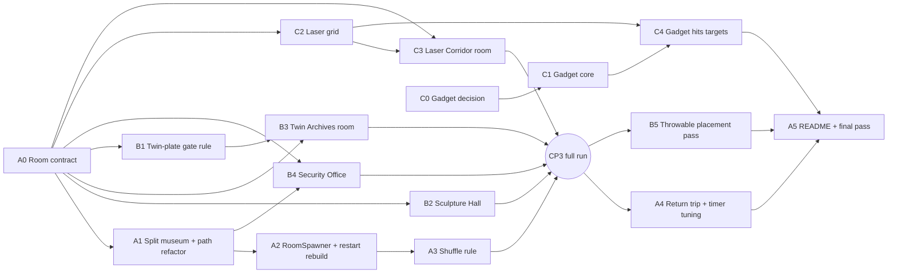

# HW #4 team plan: three developers, three coding agents

This splits HW #4 (the [spec](hw4_spec.md)) into three tracks that can run at the same time.
The art that goes into the rooms is in [hw4_assets_plan.md](hw4_assets_plan.md), in priority order.
The design behind the rooms is in [hw4_rooms_plan.md](hw4_rooms_plan.md). This doc covers
**who does what, in what order, and what blocks what**.

| Track | Focus | Developer |
|---|---|---|
| **A: Layout & networking** | Room contract, splitting the museum, room spawner, shuffle, restart, integration | _assign at kickoff_ |
| **B: Rooms & co-op puzzles** | Sculpture Hall, Twin Archives, Security Office, gate rules, throwable placement | _assign at kickoff_ |
| **C: Gadget & Laser Corridor** | The HW #4 gadget, laser grid, Laser Corridor room | _assign at kickoff_ |

---

## 1. Dependency overview

Only one task blocks everyone: **A0 (room contract)**. It is small and lands first. Until it
merges, B and C work on the tasks marked *"no dependency"*.

**Hard vs soft dependencies.** *Hard* means you can't write the task without the other one.
*Soft* means you can write it, but you can't play-test it in the real game until the other one is merged.
Every task below lists both.

---

## 2. File ownership (avoids merge conflicts)

Each file has **one owner track**. Other tracks don't edit it. If you need a change, ask the owner
or make a tiny follow-up PR *after* the owner's current PR merges.

| File(s) | Owner |
|---|---|
| `scripts/room.gd`, `scripts/room_gate.gd`, `scripts/room_catalog.gd`, `scenes/rooms/room_template.tscn` | A (created in A0, then frozen; changes need a heads-up to B and C) |
| `scenes/main.tscn`, `scripts/main.gd`, `scripts/game_state.gd`, `scripts/museum_layout.gd` | A |
| `scenes/museum.tscn` (deleted in A1), `scenes/rooms/entrance_room.tscn`, `scenes/rooms/vault_room.tscn` | A |
| `scripts/artifact.gd`, `scripts/drop_zone.gd`, `scripts/throwable.gd`, `scripts/guard.gd` (path lookups only) | A |
| `ui/hud.tscn`, `scripts/hud.gd` | A |
| `scenes/rooms/sculpture_hall_room.tscn`, `twin_archives_room.tscn`, `security_office_room.tscn` | B |
| `scripts/gates/twin_plate_gate.gd` | B |
| `scripts/player.gd`, `scenes/player.tscn`, `project.godot` (the one new input action) | C |
| `scripts/gadget*.gd`, `scenes/gadget*.tscn`, `ui/gadget_hud.tscn` | C |
| `scenes/laser_grid.tscn`, `scripts/laser_grid.gd`, `scenes/rooms/laser_corridor_room.tscn` | C |
| `README.md` | Everyone adds their own lines in their own PR; A does the final pass (A5) |

**Never edited:** `.godot/` (per `CLAUDE.md`).

---

## 3. Tasks

Task IDs are used for branch names (`hw4/a1-split-museum`) and PR titles.

### Track A: Layout & networking

**A0: Room contract** · *no dependency* · **blocks all room tasks; do it first and keep it small**
- `scripts/room.gd` (`class_name Room`) reads the `Entry` and `Exit` markers and has helpers: `get_spawn_points()`,
  `get_artifact_spot()`, `get_extraction_spot()`, `get_guard_waypoints()`.
- `scripts/room_gate.gd` (`class_name RoomGate`) is a door with a synced `is_open`. `open()` and `close()` are host
  only, and `stays_open_on_return := true` opens it once the artifact is carried.
- The gadget target interface: group `"jammable"`, host-only `jam(seconds: float) -> void`.
- `scripts/room_catalog.gd` is **pre-filled with all four pool room paths**, so B and C never touch it.
  The builder skips any path whose scene doesn't exist yet.
- `scenes/rooms/room_template.tscn` has a 3 m doorway, a `NavigationRegion3D`, and all the markers. Rooms copy it.
- Done when: the headless check passes and the contract table in `hw4_rooms_plan.md` matches the code.

**A1: Split the museum + path refactor** · hard: A0
- Turn `museum.tscn` into `entrance_room` (the lobby inside the front doors, joining the exterior; the van
  and drop zone stay outside in `World/Exterior` and `World/Getaway`) and `vault_room`
  (gallery, plates, vault, artifact spot, current guard). A `World/Museum` builder places them in a **fixed order**.
- Replace the hard-coded paths: `artifact.gd`, `drop_zone.gd`, `guard.gd` waypoints, `main.gd` spawn points,
  and `throwable.gd` (`../../Players` breaks once throwables live inside rooms).
- `GameState`: the alert becomes "**any** guard alerted". Today one guard calming down calls
  `set_alert(false)` even if another is still chasing.
- Add a `debug_order` export on the builder so B and C can force their room into a run.
- Done when: the game plays **exactly like HW #3**. **Checkpoint CP1** (two-instance play-test).
- Unblocks: in-game testing of every room via `debug_order`.

**A2: RoomSpawner + restart rebuild** · hard: A1
- Add a `MultiplayerSpawner` for rooms with a `spawn_function`. The host spawns, the client rebuilds, and late join is handled.
- Restart: free the old rooms, spawn the new ones (names include a build counter), wait for the navigation map
  to sync, then respawn the players at the entrance.
- Done when: **Checkpoint CP2**. Two instances see identical rooms, and a restart rebuilds them on both.

**A3: Ordering rule** · hard: A2 (the pure shuffle function can be written in parallel with A2)
- Our own seeded Fisher–Yates on `RandomNumberGenerator` picks 3 of 4. There's a new seed per restart.
  The seed and order are printed on the host, and a `debug_seed` export makes a run reproducible.
- Only the result is sent to clients; clients never roll.

**A4: Return trip + timer tuning** · hard: CP3
- Check that gates stay open on the way back, then tune `HEIST_DURATION` for a 5-room run.

*A4 status: done.* The timer is set and all four rooms are checked. A full two-instance play-test is still to do.
- **Timer: chosen and in.** `GameState`: `BASE_DURATION` 180 s + `TIME_PER_ROOM` 30 s per pool room in the run
  (240 s for 2 rooms, 270 s for 3). The host sets it after `heist_reset`, once the museum has built the run, and syncs
  `heist_duration` so the end screen's time taken is right on both peers. Checked headless on host and client,
  including a restart from a 3-room run into a 2-room run.
- **With all four rooms (after B4):** 4,000 seeds give 3 pool rooms half the time and 2 the other half. **Laser Corridor
  is 14 m deep** (2 m over budget), so any run that picks it drops to 2 rooms, and it never appears in a 3-room run.
  Trimming it to 12 m makes every run 3 rooms. Ten hosted runs: routes 160–163 m (2 rooms) and 182 m (3 rooms), the back
  wall exactly at z −54, every guard pathing. Host and client agree on a 3-room run with both Security Office guards.

*Earlier notes (before CP3):*
- **Return trip: checked, headless.** A puzzle room's `RoomGate` (`starts_open = false`) stays shut at the start and
  while the artifact is still in the vault. It opens by itself once the book is carried or dropped, and shuts again
  on restart. A rule that opened it (like `TwinPlateGate`) is also reset by the restart, and
  `stays_open_on_return = false` keeps it shut. **Open question for C3:** should the laser grid also switch off
  on the way back, or is crossing it twice part of the challenge?
- **Route lengths** along the guard's navmesh: plaza spawn → plates → vault → drop zone, the shortest path with no detours.

  | Run | Route | Walking (5 m/s) | Sneaking (2.5 m/s) |
  |---|---|---|---|
  | HW #3 + lobby, no pool rooms | 107 m | 21 s | 43 s |
  | Lobby, Sculpture Hall, vault (main today) | 146 m | 29 s | 58 s |
  | Longest allowed: 36 m of pool rooms | 184 m | 37 s | 74 s |

  HW #3 gave 180 s for 107 m, so most of the timer goes on stealth, the puzzle and waiting out the guard, not walking.
  The longest run adds 77 m (about 31 s sneaking) **plus up to three more guarded or puzzle rooms**.
- **Timer proposal (the team decides; the timer is a gameplay rule we write):** runs now vary from 0 to 3 pool rooms
  (2 when an 18 m room is picked), so one fixed number makes short runs easy and long ones harsh. Proposal:
  **scale the timer with the run**: `180 s + 30 s per pool room` (180 / 210 / 240 / 270 s). The host already knows
  the run when it builds (`MuseumLayout.last_order`), so `GameState.start_heist()` can take the duration from it.
  If the team prefers one fixed number, **about 270 s** covers the longest run. Either way, confirm by play-testing a
  full 3-room run once CP3 lands: aim to finish with roughly 30–60 s to spare when playing carefully.

**A5: README + final integration** · hard: A4, B5, C4
- README "Systems we wrote", "Godot-provided systems" and "Known limitations". A full play-test pass.

### Track B: Rooms & co-op puzzles

**B1: Twin-plate gate rule** · *no dependency for the logic*; hard: A0 to hook into `RoomGate`
- `scripts/gates/twin_plate_gate.gd`: two `PressurePlate`s must be pressed within 2 s of each
  other to open the gate. Host only. It can be written against the existing `PressurePlate` right away.

**B2: Sculpture Hall** · hard: A0 · soft: A1 (play-test)
- One guard on a long patrol, crates for cover, one throwable spot. The exit is always open.

**B3: Twin Archives** · hard: A0, B1 · soft: A1
- Plates in two alcoves split by a wall, with the exit gate wired to B1.

**B4: Security Office** · hard: A0 · soft: A1 (needs A1's "any guard alerted" fix to behave right)
- Two guards with patrols that cross, two throwable spots. The exit is always open.

**B5: Throwable placement pass** · hard: CP3
- Balance throwable spots across all rooms, including C's corridor (coordinate with C), and check that they reset after a restart.

### Track C: Gadget & Laser Corridor

**C0: Gadget decision** · *no dependency* · **team decision at kickoff; blocks C1**
- Proposal: a **Signal Jammer**. Each player starts with 2 charges. Using one disables every `"jammable"`
  object in range for 6 s. The host validates charges and range. Alternatives are welcome; the
  `jam()` interface from A0 should fit most of them.

**C1: Gadget core** · hard: C0 · *independent of rooms*
- Add a new input action `use_gadget` in `project.godot` (and tell the team, since `CLAUDE.md` lists the action names).
  The player sends a request RPC, and the host checks charges and range. Charges live on the host and reset on `heist_reset`.
- Show the charge count in `ui/gadget_hud.tscn`, instanced in `player.tscn` (not the main HUD, which is A's).
- Can be play-tested in the current museum against a temporary test target before A1 lands.

**C2: Laser grid** · hard: A0 (jammable interface) · *independent of C1*
- `scenes/laser_grid.tscn` has a synced `is_active`. The host detects a player crossing an active grid and raises
  noise or an alert using the existing noise system. Implements `jam(seconds)`.

**C3: Laser Corridor** · hard: A0, C2 · soft: A1
- A grid that blocks the exit, plus a fallback switch (a pressure plate one player holds to drop the grid).
  The room works without the gadget.

**C4: Gadget hits targets** · hard: C1, C2 · soft: CP2 (two-instance test)
- Jamming the grid works on both peers, and the charges show correctly for each player.

---

## 4. Suggested parallel schedule

Each row is a work slot (about one sitting). Tasks in the same row can run at the same time.

| Slot | Track A | Track B | Track C |
|---|---|---|---|
| 1 | **A0** contract | B1 rule logic (against `PressurePlate`) | **C0** decide + start C1 |
| 2 | A1 split + refactor → **CP1** | B2 Sculpture Hall (after A0) | C1 gadget core |
| 3 | A2 spawner → **CP2** | B3 Twin Archives | C2 laser grid |
| 4 | A3 shuffle rule | B4 Security Office | C3 Laser Corridor |
| 5 | **CP3: full shuffled run, all three play-test together** | | |
| 6 | A4 tuning | B5 throwables | C4 gadget ↔ targets |
| 7 | **A5 README + final play-test (CP4)** | review A5 | review A5 |

## 5. Checkpoints (merge and play-test together)

| ID | After | What to play-test (two instances, host + client) |
|---|---|---|
| CP0 | A0 | Nothing to play; B and C start their room scenes from the template. |
| CP1 | A1 | Plays exactly like HW #3: puzzle, artifact, guard, van, restart. |
| CP2 | A2 | Same rooms on both peers. A late joiner sees them. A restart rebuilds them on both. |
| CP3 | A3 + B2–B4 + C3 | A full run of entrance → 3 shuffled rooms → vault and back. The order changes on restart. A guard chases through a doorway. |
| CP4 | A5 | Everything, including the gadget on both peers. Submission build. |

---

## 6. Working with coding agents

**Every agent session gets:**
- `CLAUDE.md` (auto-loaded), `docs/hw4_spec.md`, `docs/hw4_rooms_plan.md`, and this doc.
- Exactly **one task ID**. The prompt starts with:

  > Do task **B3** from `docs/hw4_team_plan.md` only. Stay inside the files Track B owns
  > (section 2). If you need a change in another track's file, stop and tell me instead of editing it.

**Rules:**
- One branch per task (`hw4/<id>-<short-name>`), branched from an up-to-date `main`. Rebase before opening the PR.
- The agent runs `godot --headless --quit` and reports errors. A human play-tests multiplayer
  (see the checkpoint table). Agents can't verify networking.
- The PR description lists the **files touched** and the **task ID**, plus any README lines added.
- The contract files from A0 are frozen. Changing them needs a message to the other two tracks first.
- Gameplay rules (puzzle conditions, guard decisions, noise, gadget rules, timer, outcome, shuffle)
  are written by the team per the course rules. Review agent output so you can explain every rule you submit.
- Any new built-in engine system goes into README → "Godot-provided systems" in the same PR.

---

## 7. Stretch goals (only after CP4 is done)

Pick in this order unless the team prefers otherwise. Each one is independent, so the three tracks can
take one each.

1. **Sneak matters:** sneaking lowers how fast guards notice you and makes footsteps quieter
   (today it only slows you down; this is in Known limitations).
2. **Security cameras:** a second `"jammable"` target that sweeps and raises the alert. It reuses the gadget.
3. **Scoring:** a time bonus, an alert penalty, and optional loot in pool rooms. Show a score on the end screen.
4. **Room progress HUD:** "Room 2 / 5" plus a small strip showing the run's order and seed.
5. **Difficulty by depth:** rooms later in the order get faster guards or wider vision cones.
6. **Grappling hook:** (a stretch goal in the spec) a vertical shortcut in one room.
7. **Larger museum:** (a stretch goal in the spec) a bigger pool of 6 or more rooms, or a branching layout with side rooms.
8. **Lobby polish:** a ready-up screen before the heist starts, and showing the host's IP for joining.
